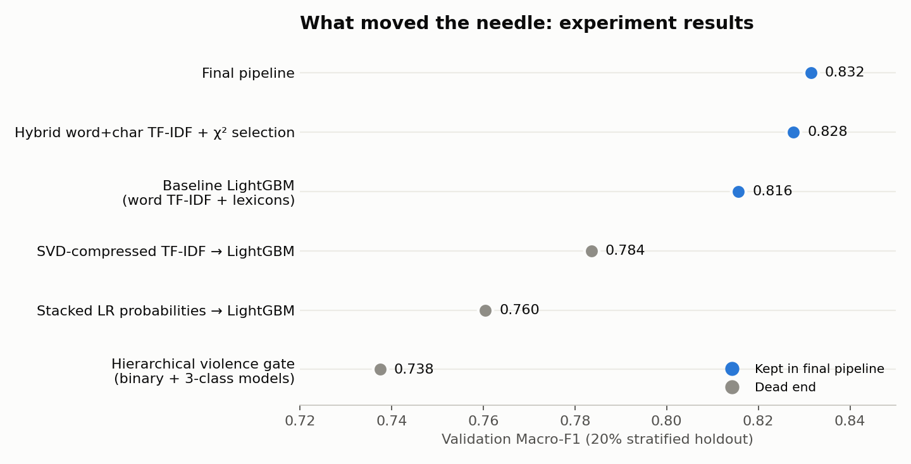
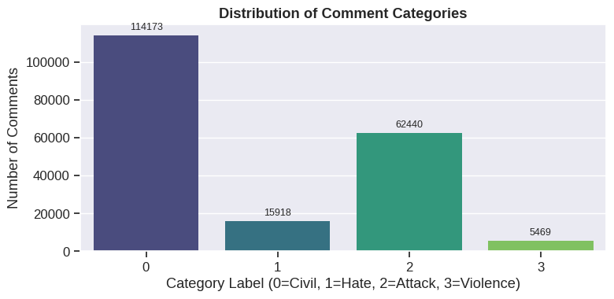
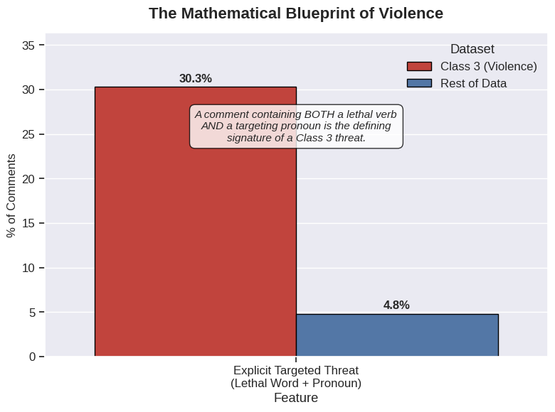
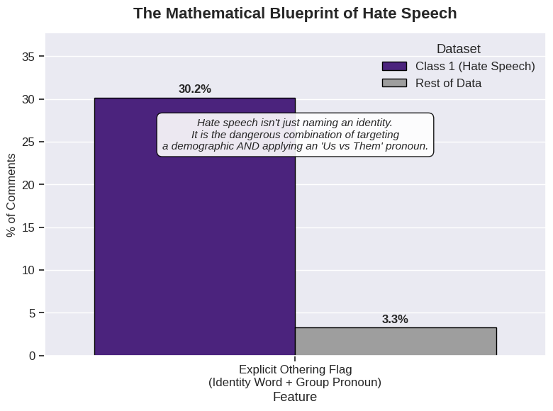
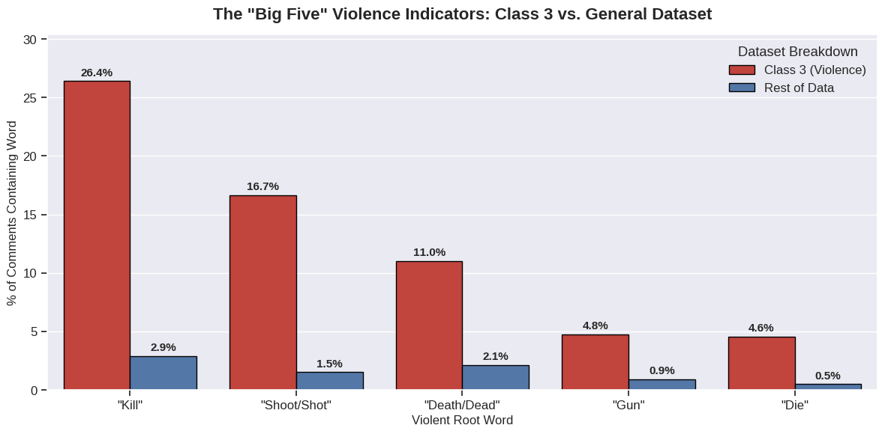
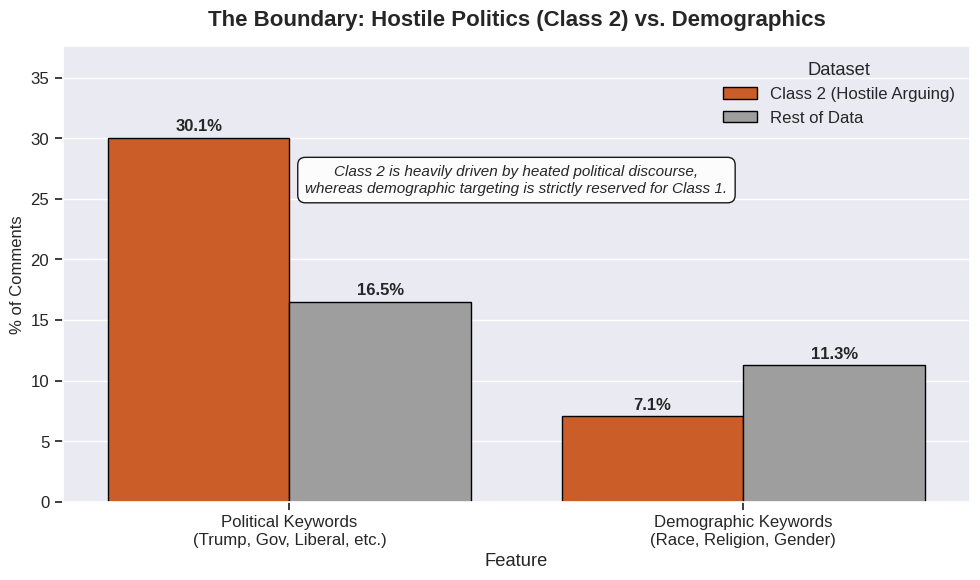

# Toxic Comment Category Prediction

**Multi-class classification of 300,000 online comments into civil, hate speech, personal attack and violent threat, scored on Macro-F1.**

**MLP Project, Jan 2026 · IIT Madras BS Degree** · Private Kaggle competition, 2,744 participants

🏅 **Final rank: 64 / 2,744 (top 2.3%)** on the private leaderboard

  

---

## Results at a glance

| | |
|---|---|
| **Private leaderboard** (final) | **0.82971** Macro-F1 · **Rank 64 / 2,744** (top 2.3%) |
| **Public leaderboard** | 0.83618 Macro-F1 · Rank 97 / 2,744 |
| **Validation Macro-F1** (20% holdout, final pipeline) | 0.8315 |
| **Starting point** (baseline LightGBM, raw argmax) | ~0.80 |
| **Feature space** | 100k hybrid TF-IDF features → 25k after χ² selection, plus 165 engineered features |
| **Models compared** | Logistic Regression (0.736) · Linear SVM via SGD (0.744) · LightGBM (0.813 raw, 0.832 after decision-boundary tuning) |



---

## The problem

Each comment comes with metadata: votes, emoticon counts, thread ID, and identity annotations for race, religion, gender and disability. The task is to assign one of four labels:

| Label | Meaning | Train count |
|---|---|---|
| 0 | Civil / normal discussion | 114,173 |
| 1 | Hate / derogatory speech | 15,918 |
| 2 | Personal attacks / hostile arguing | 62,440 |
| 3 | **Violence, threats, physical harm** | **5,469** (2.8%) |



**The core difficulty:** Macro-F1 weights all four classes equally, so the rare Class 3 counts as much as the 114k civil comments. Early models reached ~0.96 F1 on Class 0 but only **~0.58 on Class 3**: recall was 48%, because violent threats look a lot like aggressive political speech. Most of this project went into closing that gap.

---

## Approach

### 1. EDA: finding a "linguistic blueprint" for each toxic class

Instead of feeding raw text straight to a model, I compared each toxic class with the rest of the data to find patterns I could turn into features.

| Class 3: violence | Class 1: hate speech |
|---|---|
|  |  |
| A lethal word **combined with** a targeting pronoun ("you", "they") appears in **30.3%** of violent comments, against 4.8% elsewhere. | An identity word **combined with** an "us vs. them" group pronoun appears in **30.2%** of hate comments, against 3.3% elsewhere. |



- **Violent root words** are 5–10× more frequent in Class 3. For example, "kill" appears in 26.4% of violent comments vs. 2.9% of the rest.
- **Pronouns alone don't separate the classes.** "You" and "they" are equally common everywhere. Only the *interaction* with a lethal word carries signal, which is why the combined flag works.
- **Class 2 is driven by politics, not identity.** Political keywords are almost 2× more common in personal attacks, while demographic terms are *less* common there than in the rest of the data. That gives a clean boundary between Class 1 and Class 2.



### 2. Feature engineering

- **Text normalisation:** collapsed character elongations ("kiiilll youuuu" → "kil you") so stretched words still match.
- **Hybrid TF-IDF:** word 1–3-grams (50k) **plus** character 3–5-grams (50k, `char_wb`). The character n-grams catch obfuscated spellings and word roots that word tokens miss.
- **χ² feature selection:** kept the top 25% of the 100k text features (100k → 25k), which made a 3,000-tree LightGBM practical to train.
- **Hand-built lexicons:** ~120 binary indicators for violent, moral-imperative, group-identity and personal-attack terms, matched on word boundaries so that "skill" doesn't count as "kill".
- **Interaction flags:** `targeted_violence`, `othering_flag`, and `direct_attack`, all taken from the EDA above.
- **Thread-level context:** per-thread comment volume, up/down-vote mean, std and sum, total engagement, and negativity ratio.
- **Style features:** length, word count, caps ratio, `?` and `!` counts.

### 3. Modelling

Three algorithms were trained on the same 25,165-feature sparse matrix:

| Model | Validation Macro-F1 | Train time |
|---|---|---|
| Logistic Regression (`saga`, class-weighted) | 0.7362 | 230 s |
| SGDClassifier (hinge loss ≈ linear SVM) | 0.7444 | 22 s |
| **LightGBM** (64 leaves, `colsample_bytree=0.1`) | **0.8127** | 18 min |

A very low `colsample_bytree` (0.1) worked best. With 25k sparse features, each tree only needs a small random subset, which acts as strong regularisation and speeds up training.

### 4. Decision-boundary optimisation

LightGBM is trained to minimise log-loss, but the competition is scored on Macro-F1. To close that gap, I multiply the predicted probabilities by a weight vector per class and use `scipy.optimize.minimize` (Powell method, 11 different starting points) to find the weights that maximise validation Macro-F1.

- Plain argmax: **0.8127**
- Fixed rule "Class 3 if p > 0.2": 0.8259
- **Optimised per-class multipliers: 0.8315**

The final model was then retrained on all 198k rows with 3,000 trees, which took about 2 hours on Kaggle CPU.

---

## What I tried that didn't work

Negative results shaped the final design as much as the wins did. Full details are in [EXPERIMENTS.md](EXPERIMENTS.md).

| Experiment | Result | Why it failed / what I learnt |
|---|---|---|
| **Hierarchical "violence gate":** a binary Class-3 detector feeding a separate 0/1/2 model | 0.685 (soft) / 0.738 (hard) | The binary detector topped out at ~0.61 F1 on Class 3, and every gate error carried through to the second model. The limit was the **features**, not the model architecture. |
| **Stacking:** out-of-fold Logistic Regression probabilities as LightGBM features | 0.761 | The level-1 model used character 1–2-grams, which are far too short to carry meaning, so it only reached 0.43 F1. A weak stacker adds noise. |
| **Truncated SVD** to compress TF-IDF into dense features | 0.784 | 1,000 components captured only 34% of the variance. Rare, discriminative violent n-grams were the first to be lost. |
| **Pseudo-labelling:** high-confidence test predictions added to training | LB 0.83486 → **0.83349** | Confirmation bias: the model reinforced its own mistakes. Confident pseudo-labels are, by definition, the cases the model already gets right, so they add little near the hard decision boundaries. |
| **Simple threshold tuning** on Class 3 alone | Recall up, precision down | Raising one class at a time traded F1 between classes. Jointly optimising all four weights did better. |

---

## Repository structure

```
├── README.md
├── EXPERIMENTS.md                         # Detailed experiment log
├── notebooks/
│   ├── final_solution.ipynb               # Final submitted notebook (EDA → features → models → submission)
│   └── experiments/
│       ├── 01_baseline_lgbm.ipynb               # Word TF-IDF + lexicons + LightGBM
│       ├── 02_hierarchical_violence_gate.ipynb  # Binary violence detector + 3-class model
│       ├── 03_stacking_lr_probabilities.ipynb   # OOF Logistic Regression → LightGBM
│       ├── 04_hybrid_tfidf_lgbm.ipynb           # Word+char TF-IDF, χ² selection, 3000-tree LightGBM
│       └── 05_svd_and_pseudo_labeling.ipynb     # TruncatedSVD + pseudo-labelling
├── images/                                # Figures used in this README
└── requirements.txt
```

## Running it

The notebooks were written for Kaggle and read data from `/kaggle/input/comment-category-prediction-challenge/`. The competition was private, so the dataset isn't publicly available and isn't included here. If you have the data, update the paths in the first cell to run locally.

```bash
pip install -r requirements.txt
jupyter notebook notebooks/final_solution.ipynb
```

> ⚠️ The final model trains 3,000 trees on a 198k × 25k sparse matrix, which takes about 2 hours on CPU.

## Key takeaways

1. **Look at the metric first.** Macro-F1 on imbalanced data meant the rarest class decided the score, and that shaped every later decision.
2. **EDA-driven features beat model complexity.** One interaction flag (lethal word × pronoun) separated violent comments better than adding a second model to the pipeline.
3. **Character n-grams matter for noisy user text.** They handle misspellings, obfuscation and word roots without hand-written rules.
4. **Train on log-loss, then tune for the real metric.** Per-class probability weights added about +0.019 Macro-F1 at almost no cost.
5. **Validate honestly.** One experiment produced a "0.99997" score because the model had been trained on its own validation set. Catching that is now a permanent item on my checklist.
